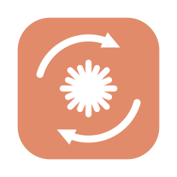
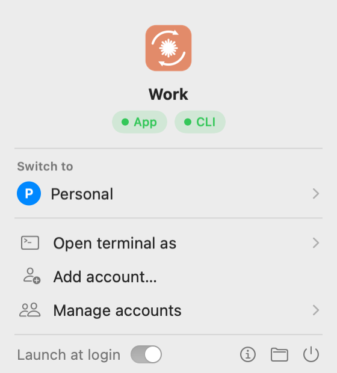
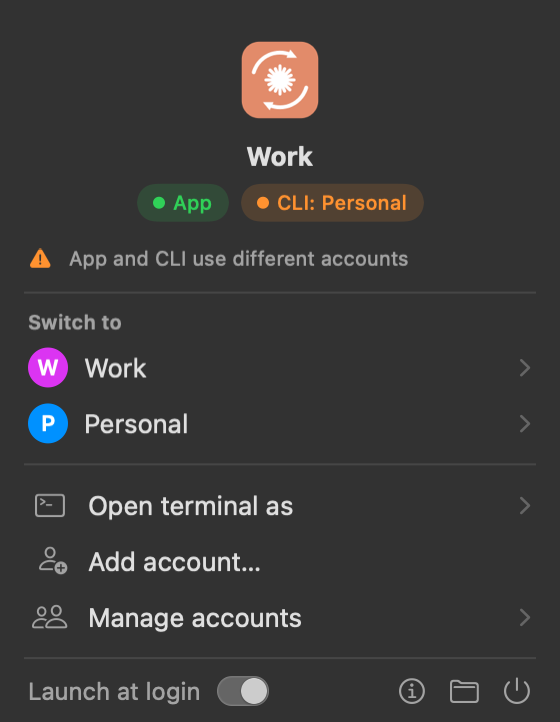

# Claude Account Switcher



A small, free macOS menu-bar app that switches the **Claude desktop app** and the **`claude` CLI (Claude Code)** between your Claude accounts with one click — for example a personal account and a work account.

> **Unofficial.** Not affiliated with or endorsed by Anthropic. "Claude" is a trademark of Anthropic. Use at your own risk.

 

## What it does

- **Switch accounts in one click.** It does the same as logging out and logging in by hand: your skills, plugins, `CLAUDE.md`, settings and sessions stay exactly as they are. Only the login changes.
- **Side-by-side terminal.** "Open terminal as" opens a Terminal where `claude` runs as another account, while the app stays on the current one. Skills, plugins, `CLAUDE.md` and settings are shared.
- **Shows when the app and the CLI are on different accounts** (a `!` next to the menu-bar icon).
- **Accounts are saved only when you ask** ("Save this account" or "Add account…").

## Install

You need macOS 15 or newer and Xcode or the Command Line Tools (`xcode-select --install`).

```bash
git clone https://github.com/<you>/claude-account-switcher.git
cd claude-account-switcher
./install.sh
```

`install.sh` builds the app from source, signs it for your Mac only (no Apple developer account needed), copies it to `~/Applications`, and opens it. Look for the two-arrows icon in the menu bar.

## First use

1. Click the menu-bar icon. It shows the account the Claude app and the CLI are using now.
2. Click **Save this account**.
3. Click **Add account…**. Claude quits and opens logged out. Log in to your other account in the Claude app, then run `claude` in Terminal and type `/login`.
4. From now on, click an account under **Switch to**. Claude quits and opens again on that account, with no login needed.

Before the very first switch the app makes a safety copy of Claude's folder (an instant APFS clone, without the large VM image) in `~/Library/Application Support/ClaudeSwitcher/backup-…`.

## Uninstall

```bash
./uninstall.sh          # removes the app, keeps your saved logins
./uninstall.sh --all    # also deletes saved logins (switch to the account you want to keep first)
```

## How it works

Each account's login is a small set of files and keys. When you switch, the app quits Claude, moves the current login into a private folder, puts the other account's login in its place, and opens Claude again. CLI login secrets stay in the macOS Keychain the whole time. Details: [docs/how-it-works.md](docs/how-it-works.md).

## Honest risks

- **It is unofficial and can break when Claude updates.** It relies on how the Claude app stores its login today. The app warns you when your Claude version is different from the one it was measured on. If switching stops working, use **ⓘ → Re-measure login…** (about 10 minutes, see [docs/step0.md](docs/step0.md)), or log in by hand as usual.
- **Your logins never leave your Mac.** There is no network code. CLI secrets go between Keychain items through pipes only, never into files, logs or command-line arguments.
- **It never deletes a saved login.** Anything unexpected goes to a `stray-…` folder. If the Mac crashes during a switch, the switch finishes the next time the app starts.
- **It must quit Claude to switch.** It asks first. It also closes running `claude` sessions in Terminal (it lists them and asks).
- The app is signed only for your Mac ("ad hoc"), so it is meant for building yourself, not for passing around as a ready-made `.app`.

## Build and test

```bash
swift test                                   # unit tests (temp folders and a fake Keychain only)
/usr/bin/python3 -I -m unittest discover -s scripts/step0
./install.sh --build                         # build without installing
```

## License

MIT — see [LICENSE](LICENSE).
